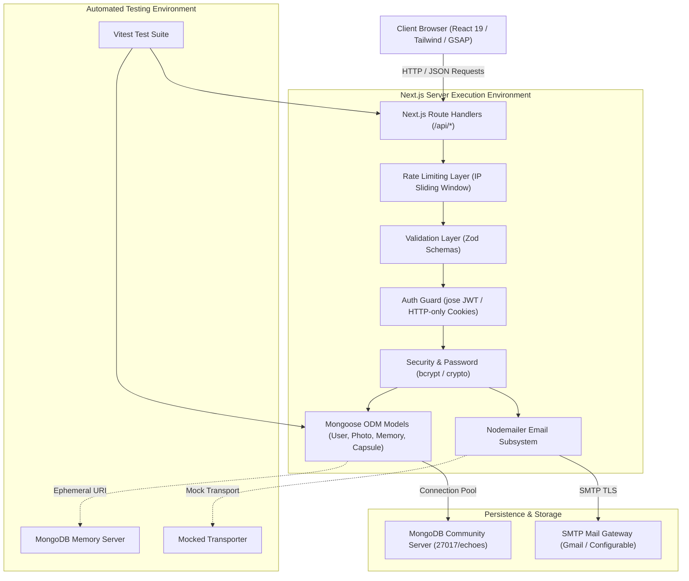

# System Architecture Specification

## ECHOES — Digital Memory Vault & Personal Time Capsule

---

## 1. Architectural Philosophy and Scope

ECHOES is architected as a modular, unified full-stack application built upon Next.js App Router and TypeScript. The system fulfills the technical and academic requirements of a Computer Science & Engineering Minor Project.

The system emphasizes:

- **Simplicity and Maintainability**: Leveraging Next.js Route Handlers as first-class REST endpoints eliminates the need for separate Express backend processes or container orchestration.
- **Strict Type Safety**: End-to-end TypeScript enforcement guarantees contracts across API handlers, database models, and validation schemas.
- **Pragmatic Technology Choices**: Using MongoDB Community Server with Mongoose ODM avoids external cloud infrastructure dependencies during local development.
- **Automated Verification**: Vitest and MongoDB Memory Server ensure fast, deterministic, offline-capable unit and integration testing.

---

## 2. High-Level Architectural Diagram

---

## 3. Subsystem Decomposition

### 3.1 Presentation Layer (Frontend - Scheduled for Phase 4)

- **Role**: Delivers interactive web user interfaces, visual timeline visualization, and time capsule countdown interfaces.
- **Technologies**: Next.js App Router (React 19), Tailwind CSS, Framer Motion, GSAP.
- **Communication**: RESTful communication with `/api/*` endpoints using JSON payloads.

### 3.2 Routing & Controller Layer (Next.js Route Handlers)

- **Role**: Serves RESTful API endpoints following standard HTTP methods (`GET`, `POST`, `PATCH`, `DELETE`).
- **Location**: `src/app/api/**/route.ts`.
- **Implemented Handlers**:
  - `POST /api/auth/register`: Account creation with bcrypt hashing, cookie minting, and welcome email.
  - `POST /api/auth/login`: Credential validation, token issuance, and HTTP-only cookie setting.
  - `POST /api/auth/logout`: Server-side token invalidation (`tokenVersion++`) and cookie clearing with CSRF protection.
  - `GET /api/auth/me`: Protected route returning authenticated user profile.
  - `POST /api/auth/forgot-password`: Generates crypto-hashed reset tokens and dispatches email.
  - `POST /api/auth/reset-password`: Single-use atomic token verification, password update, and session invalidation.
  - `PATCH /api/auth/change-password`: Current password verification, new password hashing, rate limiting, and session revocation.
  - `GET /api/health`: Operational service check.
  - `POST /api/memories`: Create personal memory with Zod validation and session-derived ownership.
  - `GET /api/memories`: List user memories with search by title/content, tag filtering, date range filtering, sort order, and pagination.
  - `GET /api/memories/:id`: Retrieve single memory with populated signed photo URLs.
  - `PATCH /api/memories/:id`: Partial memory updates with ownership verification.
  - `DELETE /api/memories/:id`: Cascade deletion of memory and associated photos from Cloudinary and MongoDB.
  - `POST /api/memories/:id/photos`: Multipart photo upload to Cloudinary with authenticated privacy delivery and compensating rollback on failure.
  - `GET /api/memories/:id/photos`: Retrieve photos for memory with signed delivery URLs.
  - `DELETE /api/memories/:id/photos/:photoId`: Purge photo from Cloudinary, delete DB record, and unlink from memory.
  - `PATCH /api/memories/:id/photos/:photoId`: Move photo to another memory with compensating safety.
  - `POST /api/capsules`: Seal time capsule with strictly future unlock date and photo ownership validation.
  - `GET /api/capsules`: List user capsules with sealed letter/photo redaction for locked capsules.
  - `GET /api/capsules/:id`: Retrieve single capsule (403 if locked, unsealed contents if unlocked).
  - `POST /api/capsules/:id/open`: Milestone unsealing endpoint setting `isOpened = true` and `openedAt`.
  - `DELETE /api/capsules/:id`: Capsule deletion preserving photos shared across memories or other capsules.
  - `GET /api/timeline`: Unified chronological timeline aggregating memories and capsules with server-side temporal redaction, type filtering, date filtering, and deterministic cursor pagination.

### 3.3 Validation Layer (Zod)

- **Role**: Boundary defense and input sanitization.
- **Location**: `src/validations/*`.
- **Schemas**:
  - `registerSchema`: Validates name length, email syntax, and password complexity.
  - `loginSchema`: Validates email and non-empty password.
  - `forgotPasswordSchema`: Validates target email address.
  - `resetPasswordSchema`: Validates reset token and new password complexity.
  - `changePasswordSchema`: Validates current password and enforces new password difference.
  - `createMemorySchema`: Validates title (1–200 chars), content (1–50,000 chars), valid memoryDate, and tags (max 20).
  - `updateMemorySchema`: Validates partial updates and ensures at least one field is provided.
  - `movePhotoSchema`: Validates target memory ID format.
  - `createCapsuleSchema`: Validates title, message, future unlockDate, and photo references.
  - `timelineQuerySchema`: Validates timeline filters (`type`, `startDate`, `endDate`), pagination (`page`, `limit`), `sortOrder`, and deterministic cursor parsing.

### 3.4 Authentication & Security Layer

- **Role**: Manages user identity, password hashing, token issuance, and session revocation.
- **Location**: `src/lib/auth/*` and `src/lib/security/*`.
- **Technologies & Mechanics**:
  - `bcrypt`: Password salting and hashing with 10 rounds.
  - `jose`: Stateless JSON Web Token (JWT) signing and verification using HMAC SHA-256 (`HS256`).
  - **Token Versioning (`tokenVersion`)**: In-database integer incremented on logout, password change, or password reset. Prevents replay attacks by invalidating all previously minted JWTs.
  - **HTTP-Only Cookies**: JWTs stored in `echoes_token` cookies with `httpOnly: true`, `sameSite: 'lax'`, and conditional `secure: true` in production.
  - **Sliding Window Rate Limiter**: Memory-based IP rate limiter defending against brute-force attacks on auth endpoints with rightmost proxy IP extraction and native `net.isIP` validation.

### 3.5 Email Subsystem (Nodemailer)

- **Role**: Dispatches transactional emails for user onboarding and account security.
- **Location**: `src/lib/email/*`.
- **Features**:
  - Environment-driven SMTP configuration (support for Gmail SMTP, custom relays, or JSON fallback).
  - Modular HTML & text templates with XSS protection via HTML entity escaping.
  - Test-friendly mock transport injection (`setTestTransporter()`).
  - Graceful error handling ensuring SMTP downtime does not abort user registration or password reset workflows.

### 3.6 Media Storage Subsystem (Cloudinary Private Delivery)

- **Role**: Secure server-side media upload, authenticated storage, and signed delivery.
- **Location**: `src/lib/media/*`.
- **Privacy Architecture**:
  - Assets uploaded using delivery type `authenticated` (`type: 'authenticated'`).
  - Prevents public URL access on Cloudinary CDN.
  - Dynamic on-demand URL signing (`sign_url: true`, `expires_at: 1 hour`) provided exclusively to authenticated resource owners.
  - Binary magic byte validation (JPEG, PNG, WebP, GIF, AVIF) and 10MB file limit before storage dispatch.
  - Compensating rollback routines that delete uploaded assets if database persistence fails.

### 3.7 Persistence Layer (MongoDB & Mongoose)

- **Role**: Document storage, indexing, and schema enforcement.
- **Location**: `src/models/*` and `src/lib/db.ts`.
- **Implemented Models & Indexes**:
  - `User`: Account credentials, token versioning, password reset metadata.
  - `Photo`: Cloudinary image assets metadata, user ownership references, and pre-delete unlinking hooks.
  - `Memory`: Chronological memories with tags, user references, photo array, and compound indices:
    - `{ userId: 1, memoryDate: -1 }` (reverse-chronological user query)
    - `{ userId: 1, memoryDate: 1, _id: 1 }` (chronological timeline query & tie-breaker)
    - `{ userId: 1, tags: 1 }` (multikey tag query)
  - `TimeCapsule`: Time-locked messages with unlock dates, `sealedAt`, `isLocked()` invariant check, and compound indices:
    - `{ userId: 1, unlockDate: 1 }` (chronological unlock query)
    - `{ userId: 1, unlockDate: 1, _id: 1 }` (chronological timeline query & tie-breaker)
    - `{ userId: 1, isOpened: 1 }` (status filter query)

### 3.8 Timeline & Chronology Subsystem

- **Role**: Aggregates memories and capsules into a unified chronological feed with deterministic ordering.
- **Implementation**:
  - Utilizes MongoDB `$unionWith` aggregation pipeline to merge user memories and capsules within the database engine.
  - Avoids N+1 queries by batch-populating photo documents for only the sliced page items.
  - Supports deterministic cursor-based pagination via URL-safe base64 `{ date, id }` tokens as well as offset-based `page`/`limit`.
  - Enforces strict server-side temporal privacy: locked capsules have their `content`, `message`, `photos`, and private Cloudinary IDs completely redacted.

### 3.9 Automated Testing Infrastructure

- **Role**: Continuous regression testing and code validation.
- **Location**: `tests/*`.
- **Status**: 179 automated unit and integration tests across 13 test files executing against isolated `mongodb-memory-server` and mocked Cloudinary/email transports with 100% pass rate.
