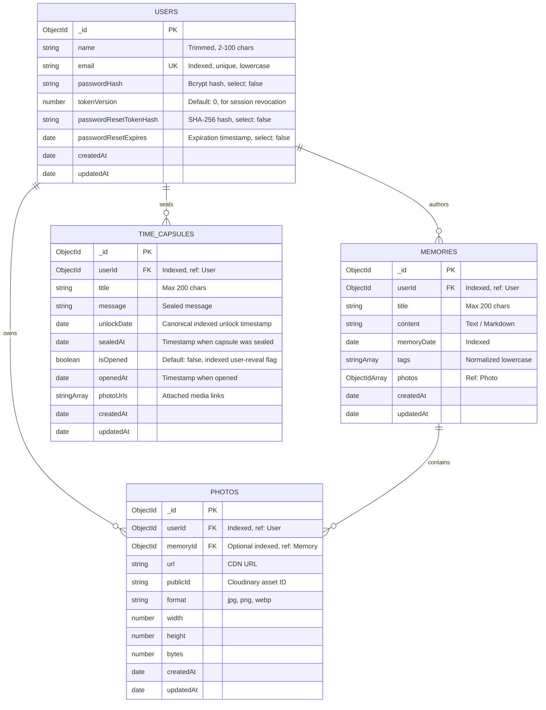

# Database Design & Schema Specification

## ECHOES — Digital Memory Vault & Personal Time Capsule

---

## 1. Overview & Database Engine

The persistence layer for **ECHOES** is implemented using **MongoDB Community Server** and modeled via **Mongoose (ODM)**. MongoDB's document-oriented model was chosen for its flexibility in handling semi-structured personal narratives, variable photo attachment arrays, and evolving time capsule metadata.

- **Engine**: MongoDB Community Server 8.x
- **Development URI**: `mongodb://127.0.0.1:27017/echoes`
- **Testing Engine**: In-memory ephemeral MongoDB via `mongodb-memory-server`
- **Current Status**: **Phase 1 Completed & Audited** — All core models (`User`, `Photo`, `Memory`, `TimeCapsule`) are implemented, indexed, and audited for bidirectional integrity, concurrency safety, and date-locking invariants.

---

## 2. Entity Relationship Diagram



---

## 3. Implemented Schemas

### 3.1 User Collection (`users`) — [`src/models/User.ts`](file:///home/abhi/Projects/echos/src/models/User.ts)

| Field Name               | Type       | Modifiers / Constraints                       | Description                                             |
| :----------------------- | :--------- | :-------------------------------------------- | :------------------------------------------------------ |
| `_id`                    | `ObjectId` | Primary Key, Auto-generated                   | Unique record identifier                                |
| `name`                   | `String`   | Required, Trimmed, 2–100 characters           | Full user display name                                  |
| `email`                  | `String`   | Required, Unique, Trimmed, Lowercase, Indexed | User login email address                                |
| `passwordHash`           | `String`   | Required, `select: false`                     | `bcrypt`-hashed password string                         |
| `tokenVersion`           | `Number`   | Default: `0`                                  | Monotonically increasing counter for session revocation |
| `passwordResetTokenHash` | `String`   | Optional, `select: false`                     | SHA-256 hash of password reset token                    |
| `passwordResetExpires`   | `Date`     | Optional, `select: false`                     | Expiration timestamp for reset token                    |
| `createdAt`              | `Date`     | Timestamp, Managed by Mongoose                | Record creation date                                    |
| `updatedAt`              | `Date`     | Timestamp, Managed by Mongoose                | Record last modified date                               |

**Serialization Transform (`toJSON` / `toObject`)**:
Automatically strips `passwordHash`, `passwordResetTokenHash`, `passwordResetExpires`, and `__v` from returned JSON payloads to prevent credential leaks.

### 3.2 Photo Collection (`photos`) — [`src/models/Photo.ts`](file:///home/abhi/Projects/echos/src/models/Photo.ts)

| Field Name  | Type       | Modifiers / Constraints            | Description                             |
| :---------- | :--------- | :--------------------------------- | :-------------------------------------- |
| `_id`       | `ObjectId` | Primary Key, Auto-generated        | Unique photo record identifier          |
| `userId`    | `ObjectId` | Required, Ref to `User`, Indexed   | Owner reference                         |
| `memoryId`  | `ObjectId` | Optional, Ref to `Memory`, Indexed | Memory entry reference                  |
| `url`       | `String`   | Required, Trimmed                  | Public CDN access URL                   |
| `publicId`  | `String`   | Required, Trimmed                  | Cloudinary asset public identifier      |
| `format`    | `String`   | Optional                           | Asset file format (`jpg`, `webp`, etc.) |
| `width`     | `Number`   | Optional                           | Pixel width                             |
| `height`    | `Number`   | Optional                           | Pixel height                            |
| `bytes`     | `Number`   | Optional                           | File size in bytes                      |
| `createdAt` | `Date`     | Timestamp                          | Record creation date                    |
| `updatedAt` | `Date`     | Timestamp                          | Last modified date                      |

**Indexing & Integrity**:

- Compound index `{ userId: 1, memoryId: 1 }` enables high-performance queries for photos belonging to specific memories of a user.
- Unique index on `{ publicId: 1 }` prevents duplicate Cloudinary assets.
- Pre-delete query middleware (`findOneAndDelete`) and document instance middleware (`deleteOne`) on `PhotoSchema` automatically execute `$pull: { photos: doc._id }` on associated `Memory` documents, eliminating orphaned references across all deletion methods.

### 3.3 Memory Collection (`memories`) — [`src/models/Memory.ts`](file:///home/abhi/Projects/echos/src/models/Memory.ts)

| Field Name   | Type         | Modifiers / Constraints                   | Description                     |
| :----------- | :----------- | :---------------------------------------- | :------------------------------ |
| `_id`        | `ObjectId`   | Primary Key, Auto-generated               | Unique memory identifier        |
| `userId`     | `ObjectId`   | Required, Ref to `User`, Indexed          | Owner reference                 |
| `title`      | `String`     | Required, Trimmed, Max 200 chars          | Memory title                    |
| `content`    | `String`     | Required                                  | Memory narrative text           |
| `memoryDate` | `Date`       | Required, Indexed                         | Date of the actual event/memory |
| `tags`       | `[String]`   | Array of strings, Lowercase normalization | Category tags                   |
| `photos`     | `[ObjectId]` | Ref array to `Photo` collection           | Attached photos                 |
| `createdAt`  | `Date`       | Timestamp                                 | Record creation date            |
| `updatedAt`  | `Date`       | Timestamp                                 | Last modified date              |

**Indexing & Query Performance Patterns**:

- Compound index `{ userId: 1, memoryDate: -1 }` guarantees high-speed chronological timeline queries per user.
- Multikey compound index `{ userId: 1, tags: 1 }` enables efficient index-backed `$in` tag filtering without scanning non-matching documents.
- **Unanchored Substring Search Behavior**: Queries containing `search` evaluate case-insensitive regex (`$or: [{ title: regex }, { content: regex }]`). Because unanchored regexes cannot perform B-tree index seeks, MongoDB relies on the `{ userId: 1, memoryDate: -1 }` or `userId: 1` index to narrow down documents to the authenticated user first, then applies regex matching strictly across that user's subset of documents.
- Pre-delete query middleware (`findOneAndDelete`) and document instance middleware (`deleteOne`) on `MemorySchema` automatically unlink referenced photos by executing `$set: { memoryId: null }` on the `Photo` collection.
- Cascade deletion in `DELETE /api/memories/:id` purges all associated photos from Cloudinary and deletes `Photo` records. If Cloudinary destruction fails, database records are preserved and HTTP 502 is returned to allow safe retry.

### 3.4 Time Capsule Collection (`time_capsules`) — [`src/models/TimeCapsule.ts`](file:///home/abhi/Projects/echos/src/models/TimeCapsule.ts)

| Field Name   | Type         | Modifiers / Constraints          | Description                                           |
| :----------- | :----------- | :------------------------------- | :---------------------------------------------------- |
| `_id`        | `ObjectId`   | Primary Key, Auto-generated      | Unique capsule identifier                             |
| `userId`     | `ObjectId`   | Required, Ref to `User`, Indexed | Owner reference                                       |
| `title`      | `String`     | Required, Trimmed, Max 200 chars | Capsule title / subject                               |
| `message`    | `String`     | Required                         | Letter to future self                                 |
| `unlockDate` | `Date`       | Required, Indexed                | **Canonical field**: Future date when capsule unlocks |
| `sealedAt`   | `Date`       | Required, Default: `Date.now`    | Exact timestamp when the capsule was sealed           |
| `isOpened`   | `Boolean`    | Default: `false`, Indexed        | Tracks whether the user has revealed the capsule      |
| `openedAt`   | `Date`       | Optional, Default: `null`        | Timestamp when capsule was first unsealed             |
| `photos`     | `[ObjectId]` | Ref to `Photo`, Optional array   | References to attached photo documents in `photos`    |
| `photoUrls`  | `[String]`   | Optional array of URLs           | Attached photograph links                             |
| `createdAt`  | `Date`       | Timestamp                        | Record creation date                                  |
| `updatedAt`  | `Date`       | Timestamp                        | Last modified date                                    |

#### Schema Decisions & Locking Invariants

1. **Canonical Field Naming**: `unlockDate` is the canonical schema field, preserving symmetry with `memoryDate`. A virtual alias [`unlockAt`](file:///home/abhi/Projects/echos/src/models/TimeCapsule.ts#L85) is provided as both a getter and setter to prevent naming confusion.
2. **`sealedAt` Representation**: Dedicated `sealedAt: Date` field records the formal sealing event, distinct from `createdAt`.
3. **`isOpened` vs. Date Verification**: `isOpened` is purely a user-state flag indicating if the unsealing interaction was executed. It **cannot and must not be used as a substitute for verifying `unlockDate`**. The schema provides the instance method [`isLocked(now?: Date)`](file:///home/abhi/Projects/echos/src/models/TimeCapsule.ts#L94):
   ```ts
   isLocked(now: Date = new Date()): boolean {
     return now < this.unlockDate;
   }
   ```
   Access to sealed message content is strictly forbidden while `isLocked()` evaluates to `true`, regardless of `isOpened`.
4. **Photo Reference Integrity**: `TimeCapsule` maintains a `photos: [ObjectId]` array referencing `Photo` documents. `Photo` schema registers pre-delete hooks that automatically pull removed photo IDs from `TimeCapsule.photos`, preventing dangling references. Photo deletion on capsule removal only destroys exclusive photos (`memoryId == null`), preserving shared photos.

---

---

## 4. Indexing Strategy Summary

1. `users`:
   - `{ email: 1 }` (Unique, B-tree index for fast user lookup during auth).
2. `photos`:
   - `{ userId: 1 }` (User photo ownership isolation).
   - `{ memoryId: 1 }` (Foreign key lookups for memory attachments).
3. `memories`:
   - `{ userId: 1, memoryDate: -1 }` (Compound reverse-chronological index for memory feed).
   - `{ userId: 1, memoryDate: 1, _id: 1 }` (Compound chronological index for unified timeline with deterministic tie-breaking).
   - `{ userId: 1, tags: 1 }` (Multikey compound index for tag filtering).
4. `time_capsules`:
   - `{ userId: 1, unlockDate: 1 }` (Compound lock query index).
   - `{ userId: 1, unlockDate: 1, _id: 1 }` (Compound chronological index for unified timeline with deterministic tie-breaking).
   - `{ userId: 1, isOpened: 1 }` (Compound status index).

---

## 5. Timeline Aggregation Pipeline & Pagination Architecture (Phase 4)

### 5.1 MongoDB `$unionWith` Aggregation

To assemble a unified chronological stream without loading all user archives into application RAM, `GET /api/timeline` executes an aggregation pipeline merging `memories` and `timecapsules` at the database level:

```ts
[
  { $match: { userId: user._id, ...(startDate || endDate ? { memoryDate: dateFilter } : {}) } },
  {
    $project: {
      _id: 1,
      type: { $literal: 'memory' },
      title: 1,
      date: '$memoryDate',
      content: 1,
      tags: 1,
      photos: 1,
      createdAt: 1,
      updatedAt: 1,
    },
  },
  {
    $unionWith: {
      coll: 'timecapsules',
      pipeline: [
        {
          $match: { userId: user._id, ...(startDate || endDate ? { unlockDate: dateFilter } : {}) },
        },
        {
          $project: {
            _id: 1,
            type: { $literal: 'capsule' },
            title: 1,
            date: '$unlockDate',
            unlockDate: 1,
            sealedAt: 1,
            isOpened: 1,
            openedAt: 1,
            message: 1,
            photos: 1,
            photoUrls: 1,
            createdAt: 1,
            updatedAt: 1,
          },
        },
      ],
    },
  },
  { $sort: { date: sortDirection, _id: sortDirection } },
  { $skip: skip },
  { $limit: limit },
];
```

### 5.2 Deterministic Cursor Pagination vs. Offset Pagination

1. **Deterministic Cursor Strategy**:
   - Cursor tokens are URL-safe base64 strings encoding `{ date: ISOString, id: ObjectIdString }`.
   - Seeking query uses composite comparison:
     - Ascending: `{ $or: [ { date: { $gt: cursor.date } }, { date: cursor.date, _id: { $gt: cursor.id } } ] }`
     - Descending: `{ $or: [ { date: { $lt: cursor.date } }, { date: cursor.date, _id: { $lt: cursor.id } } ] }`
   - Guarantees $O(1)$ seek efficiency even at deep offsets and eliminates duplicate or skipped items when new memories/capsules are concurrently inserted.
   - Malformed, corrupt, or tampered cursors are rejected with `400 Bad Request`.
2. **Offset Pagination Limitations**:
   - Traditional `page`/`limit` (`skip = (page - 1) * limit`) is supported for standard UI pagination widgets.
   - If a new memory or capsule is sealed while a user traverses offset pages, items may shift positions across page boundaries.
