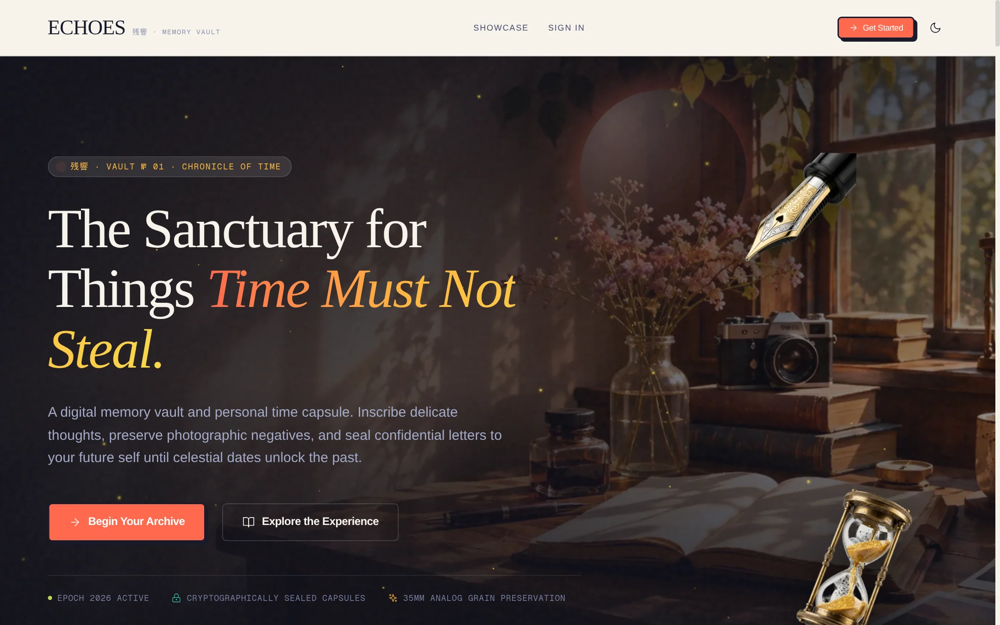
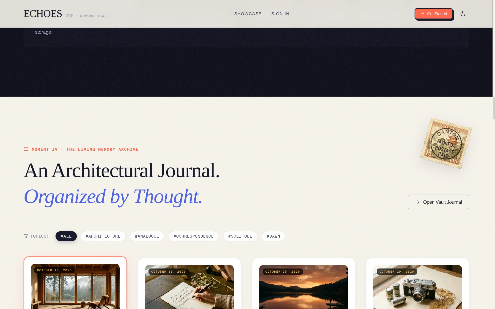
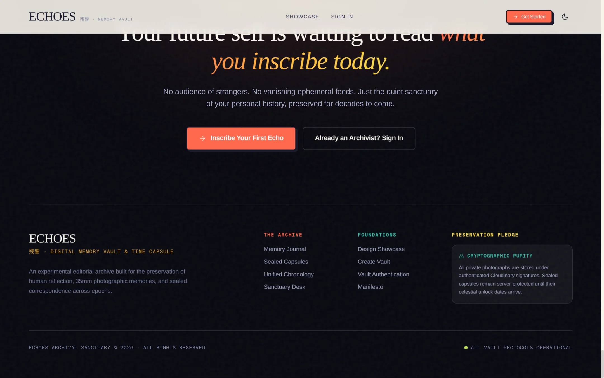

# Echoes Landing Page — Visual Showcase

Here are the 4 high-resolution captures of the reinvented Echoes landing page across its key narrative moments and viewport states.

---

## 1. Hero Section — The Vault of Elapsed Moments

Full desktop composition with warm golden-hour sanctuary photography, floating vintage fountain pen nib and hourglass physics, procedural dust motes, and experimental monumental typography.

- **Original PNG**: [`public/images/report/echoes_hero_section.png`](file:///home/abhi/Projects/echos/public/images/report/echoes_hero_section.png) (2160 × 1350 px, 2.3 MB)
- **WebP**: [`public/images/report/echoes_hero_section.webp`](file:///home/abhi/Projects/echos/public/images/report/echoes_hero_section.webp) (148 KB)

---

## 2. Middle Section — The Time Capsule Sealing Chamber

The atmospheric Midnight chamber featuring the precision brass astronomical astrolabe, kinetic GSAP needle calibration, live horizon counter, and molten coral wax seal simulation.

- **Original PNG**: [`public/images/report/echoes_sealing_chamber.png`](file:///home/abhi/Projects/echos/public/images/report/echoes_sealing_chamber.png) (2160 × 1350 px, 1.9 MB)
- **WebP**: [`public/images/report/echoes_sealing_chamber.webp`](file:///home/abhi/Projects/echos/public/images/report/echoes_sealing_chamber.webp) (121 KB)

---

## 3. Final CTA & Archival Footer — Epilogue

The closing crescendo featuring monumental typography ("Your future self is waiting..."), interactive molten coral wax seal centerpiece, secondary actions, and the multi-column archival footer with preservation pledge.

- **Original PNG**: [`public/images/report/echoes_final_cta_footer.png`](file:///home/abhi/Projects/echos/public/images/report/echoes_final_cta_footer.png) (2160 × 1350 px, 1.5 MB)
- **WebP**: [`public/images/report/echoes_final_cta_footer.webp`](file:///home/abhi/Projects/echos/public/images/report/echoes_final_cta_footer.webp) (96.5 KB)

---

## 4. Full-Page Desktop Landing Page (All 8 Moments)

The complete vertical journey through all eight narrative moments: Hero, Manifesto, 35mm Contact Sheet, Memory Archive, Sealing Chamber, Chronology Spine, Product Showcase, and Epilogue.

- **Full Resolution PNG (1:1)**: [`public/images/report/echoes_full_page_desktop.png`](file:///home/abhi/Projects/echos/public/images/report/echoes_full_page_desktop.png) (1433 × 22,883 px, 17 MB)
- **WebP Preview**: [`public/images/report/echoes_full_page_desktop_preview.webp`](file:///home/abhi/Projects/echos/public/images/report/echoes_full_page_desktop_preview.webp) (900 × 14,371 px, 233 KB)
